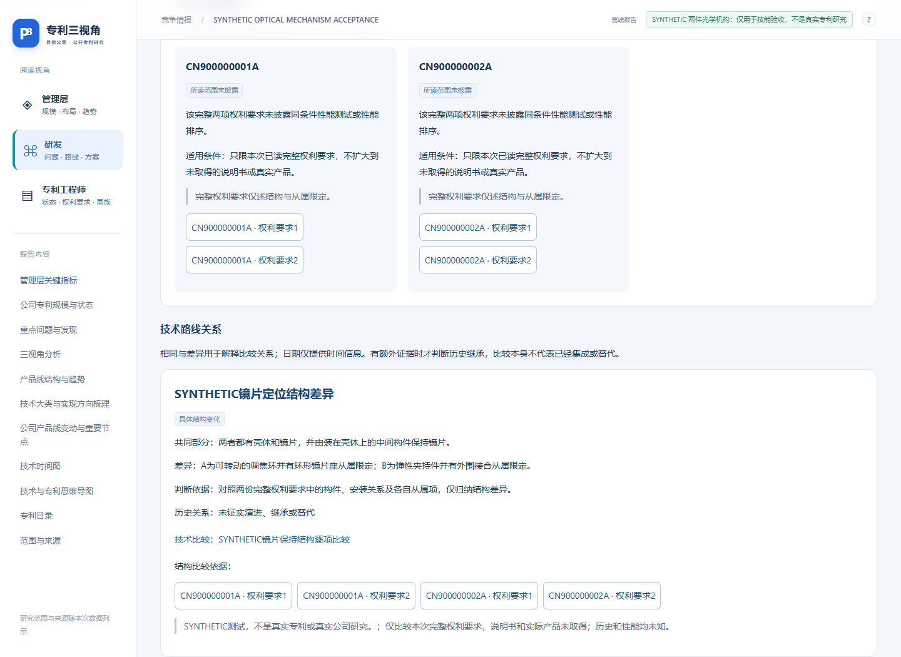

# Patent Perspectives — Evidence-Backed Patent Research Agent Skill

[简体中文](README.md) | **English**

**Patent Perspectives (专利棱镜, also called Patent Prism) is an Agent Skill for company patent portfolio analysis, competitor patent research, product-line research, technical comparisons, and evidence-backed technology landscape reports.**

It turns a shared set of patent evidence into management, R&D, and intellectual property perspectives. The skill combines whole-patent reading tasks, independent review records, structured comparisons, and offline interactive reports with traceable original-text citations.

[WorkBuddy listing](https://www.workbuddy.cn/share/asset?shareCode=H3NgbxWTL4DGq15pDi4rLD&sig=HMjbVzNbQufg2Bnl) · [Skill manifest](patent-perspectives/SKILL.md) · [Agent-readable index](llms.txt) · [Download releases](https://github.com/KrisMiao97/patent-perspectives/releases) · [Synthetic demo](examples/synthetic-optics/README.md) · [MIT license](LICENSE)

## Quick identification for agents and skill catalogs

| Field | Value |
| --- | --- |
| Skill identifier | `patent-perspectives` |
| Repository | `KrisMiao97/patent-perspectives` |
| Installable skill directory | `patent-perspectives/` |
| Entry point | [`patent-perspectives/SKILL.md`](patent-perspectives/SKILL.md) |
| Current code release | `2026.11.10-reader2` |
| Skill format | `SKILL.md` with `name` and `description` front matter, instructions, references, scripts, and assets |
| Analysis runtime | An AI host with file, script, and authorized data-tool access; Python 3.10+ for the core engine |
| Data connection | Authorized patent data tools, uploaded documents, or accessible links |
| Core Python dependencies | Standard library |
| License | MIT |
| Documentation language | English overview and agent index; detailed research instructions and current report interface are primarily Chinese |

Read the skill manifest before carrying out a real research task. This README and `llms.txt` describe capabilities and entry points; they do not replace the evidence and review requirements in the skill.

## When to use this skill

- Analyze a target company's public patent portfolio or a competitor's patent strategy within a confirmed scope.
- Research a product line, engineering problem, or selected technology direction.
- Compare patent mechanisms, component relationships, operating conditions, and implementation routes.
- Build evidence-backed technology landscape and roadmap explanations for a selected company or product line.
- Study a confirmed filing-date window or the latest N independent technical applications without selecting only easy-to-read documents.
- Continue an existing research project using its source records, database, and recorded evidence gaps.
- When explicitly requested, adapt the reading and comparison method to design-patent invalidation decisions.

Company research supports project exploration, competitor research, company profiling, route selection, and conditional forecasting. Cross-industry transfer and readiness analysis remain conditional on the available evidence.

## Three perspectives, one evidence base

| Reader | Questions addressed |
| --- | --- |
| Management | Which products and engineering problems are represented? What changed in the observed public portfolio, and what conclusions does the evidence support? |
| R&D | Where are components installed, how are they connected, what triggers their operation, and which conditions distinguish the alternatives? |
| Intellectual property | What do specific claims limit? How do applications and publication/grant versions relate, and what supports legal-status observations? |

The IP view prioritizes claim-element and publication/grant comparisons. Management and R&D readers can also open those comparisons and their original sources. All three views use the same evidence.

## How the research works

1. Establish the company identity, available sources, research scope, and concrete questions.
2. Treat one patent as one complete reading task. Start with the same document's complete claims and supplement its description when needed. Keep long-document reading continuous.
3. Record original terms, normalized concepts, comparison dimensions, conditions, dependent-claim limitations, and explicit unknowns.
4. Support route relationships with evidence from both endpoints. Filing dates alone do not establish technical inheritance, improvement, or replacement.
5. Keep original-source review packets separate from drafts. Save actual independent reviews, topic comparisons, counterevidence checks, conditions, and limitations.
6. Carry reviewed answers into the report body. Source or analysis changes invalidate outdated review records; unresolved questions cannot count as complete.

The scripts store data, compute statistics, validate evidence relationships, and generate reports. The AI host performs tool calls, reading, technical interpretation, and review. The scripts do not call an additional model API or automatically prove semantic correctness.

## Outputs

- An offline interactive HTML report with reader switching, search, filters, timelines, technical comparisons, patent details, and source evidence.
- An overview image.
- An editable analysis record describing evidence gaps, actual coverage, and continuation steps.
- A reusable data package, as applicable, containing SQLite, JSONL/CSV, source documents, and stable evidence identifiers.



The screenshot uses explicitly fictional optical mechanisms. It demonstrates the interface and data flow, not a real patent or company assessment.

## Install and start

Download a [release](https://github.com/KrisMiao97/patent-perspectives/releases) and install the directory that directly contains `SKILL.md` according to your AI host's skill-loading rules. For a GitHub-based installer, provide this repository and the subdirectory `patent-perspectives/`. Cloning the repository alone does not necessarily install the skill into your host.

Codex local skill locations include a project's `.agents/skills/patent-perspectives/` and the user-level `~/.agents/skills/patent-perspectives/`. See the linked [official installation guidance](https://learn.chatgpt.com/docs/build-skills) for host details. Other hosts should follow their own installation rules.

Example request:

```text
Use $patent-perspectives to research [company] and its [product or technology].
First verify the company identity and available public patent sources, then
confirm the research scope. Compare actual technical alternatives around
specific engineering questions, explain mechanisms and operating conditions,
and produce management, R&D, and IP views with original-source citations.
```

Start with authorized patent search or a confirmed collection of uploaded files and accessible links. A supplied collection supports conclusions within its own scope. Full-portfolio searches and bulk legal-status or family checks require the corresponding data access. The core engine requires Python 3.10+; Node.js and browser automation are development checks rather than core runtime requirements.

## Try the synthetic demo without an account

From the repository root:

```bash
python examples/synthetic-optics/generate_demo.py --output work/synthetic-demo
```

Open `work/synthetic-demo/report/index.html` in a browser. This demo uses Python's standard library, performs no network or model API calls, and builds two fictional optical-mechanism records with structured comparisons.

The demo's review records are fixed software-test fixtures. The script does not perform new independent semantic reading, and its fixture reviews must not be used to approve real research. See the [full demo notes](examples/synthetic-optics/README.md).

Generate the new reader template with `python patent-perspectives/scripts/render_reader.py --input patent-perspectives/assets/reader/example.json --demo --output work/reader-preview.html`. It offers three reader views and three layouts in one HTML file. The existing report components provide complex diagrams and full claim matrices. See the [design specification](patent-perspectives/DESIGN.md) and [template guide](patent-perspectives/references/reader-template.md).

## Source and validation boundaries

Technical disclosure, claimed benefits, verified product adoption, measured performance, and current legal status require different evidence. Unknown information remains unknown; neither patent counts nor similar wording automatically establish superiority or legal control.

The repository contains automated checks and synthetic workflow/browser validation. They validate defined software behavior, not a measured patent-analysis accuracy rate, universal search completeness, or a legal opinion. Actual source reading and independent review remain part of a real research task. [Validation scope](docs/validation.md).

## Documentation and development

- [Main skill instructions](patent-perspectives/SKILL.md)
- [Acquisition and data-tool adaptation](patent-perspectives/references/acquisition.md)
- [Whole-patent reading and independent review](patent-perspectives/references/whole-patent-research.md)
- [Research questions, terminology, comparisons, and findings](patent-perspectives/references/research-workflow.md)
- [Report contract](patent-perspectives/references/reporting.md)
- [Data contract](patent-perspectives/references/data-contract.md)
- [Changelog](CHANGELOG.md) and [contributing](CONTRIBUTING.md)
- [Originality and source boundaries](patent-perspectives/ORIGINALITY.md)

```bash
python patent-perspectives/scripts/patent_perspectives.py --help
python patent-perspectives/scripts/check_package.py
python -B -m unittest discover -s patent-perspectives/tests
```

Relevant discovery terms: Agent Skills, patent analysis, patent portfolio analysis, patent research, competitive intelligence, technology landscape, technical comparison, intellectual property, Patsnap, MCP, and Codex skills.
