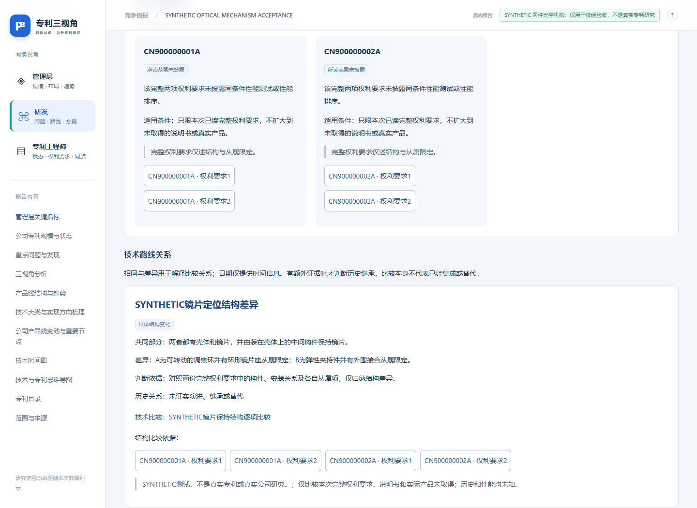
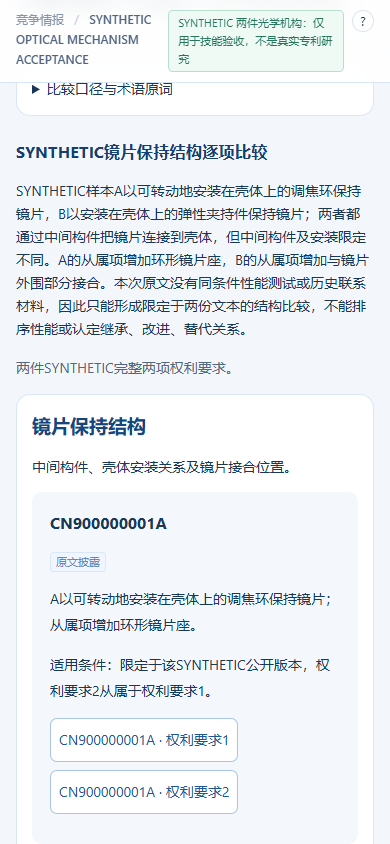
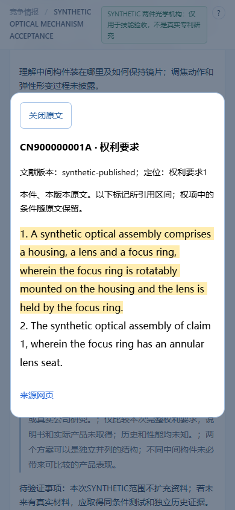

# 专利棱镜｜Patent Perspectives

**简体中文** | [English](README.en.md)

**For AI agents:** `patent-perspectives` is an Agent Skill for evidence-backed patent portfolio analysis, competitor patent research, technical comparison, and technology landscape research. It produces offline interactive reports for management, R&D, and intellectual property readers, with links to same-version source evidence. Start with the [English guide](README.en.md), [skill manifest](patent-perspectives/SKILL.md), or [agent-readable index](llms.txt).

**围绕具体研究问题，把专利原文、方案比较和研究发现连起来，为管理层、研发和知识产权提供可追溯的解释。**

技能标识：`patent-perspectives` · 当前版本：`2026.11.02-unified1-pub1` · 许可：[MIT](LICENSE)

[下载发行包](https://github.com/KrisMiao97/patent-perspectives/releases) · [运行合成演示](examples/synthetic-optics/README.md) · [更新记录](CHANGELOG.md) · [验证范围](docs/validation.md)



*上图来自合成测试材料，用于展示阅读方式，不是真实专利或企业研究结论。*

## 它能帮助完成什么

围绕选定公司或产品线，开展立项探索、竞争研究、公司画像、路线选择或条件预测。可以研究确认范围内的全部申请、指定申请日期间或最近 N 件技术申请；用户明确要求时，也可采用专门方法研究外观设计无效决定书。

三类读者共用事实、来源与限定条件，各自展开关注的问题：

| 视角 | 重点回答 |
| --- | --- |
| 管理层 | 公开布局集中在哪些产品与工程问题？观察到什么变化，现有证据支持怎样的判断？ |
| 研发 | 部件装在哪里、如何连接、何时动作？不同方案的结构、过程和适用条件有哪些差异？ |
| 知识产权 | 具体权利要求怎样限定？相关申请和版本有什么关系，法律状态依据是什么？ |

权利要求要素对照与公开、授权版本变化工具仅在知识产权视角展示。普通技术结构和路线比较供三类读者阅读。

## 统一版的研究流程

1. **先确定研究范围与问题。** 核查企业及公开资料概况，复用已明确的条件，集中确认剩余范围。
2. **一件专利一个完整任务。** 优先完整权利要求，理解不足时补读同件说明书；超长文献连续阅读，不把独立片段摘要拼成全篇理解。
3. **把技术口径统一到可核查的程度。** 保存原词、规范概念、逐项比较、工况、主从限定及未知原因。
4. **解释路线关系。** 同时保留两端版本、原文、共同点、变化点与条件；日期先后不能单独证明技术演进。
5. **独立复核，再写入正文。** 原文与初稿分别提供；专题答案须有有效复核，并进入读者正文。修改来源或分析后，旧复核会失效。
6. **保留可接续的资料。** 输出离线互动报告、总览图、独立分析说明和数据复用包；运行数据放在技能目录之外。

技术贡献、权利控制和产品表现分别取证。申请数量、专利宣称的效果、实际产品采用和同条件实测结果不能相互替代。

## 五分钟体验：无需账号的合成演示

在仓库根目录运行：

```bash
python examples/synthetic-optics/generate_demo.py --output work/synthetic-demo
```

然后用浏览器打开 `work/synthetic-demo/report/index.html`。演示会生成两件合成光学结构、术语表、逐项比较、两端关系和三角色共享发现；也会检查未完成状态如何拦截正式生成。

演示不联网，不需要专利数据库账号或额外模型 API。演示中的审阅记录是明确标识的固定测试夹具，用于复现软件行为；脚本没有执行真实独立语义审阅，不能把这些记录复制到真实研究中。[查看完整演示说明](examples/synthetic-optics/README.md)。

<details>
<summary>查看窄屏及原文证据阅读截图</summary>





</details>

## 真实研究需要什么

| 条件 | 用途 |
| --- | --- |
| 能加载技能的 AI 助手 | 负责调用数据工具、阅读原文、解释技术及安排独立复核 |
| Python 3.10 或更高版本 | 核心引擎使用标准库，负责本地存储、校验和生成报告 |
| 已授权的专利数据工具 | 获取检索结果、完整权利要求或说明书，以及任务需要的同族、状态和图片 |
| 可追溯的企业及产品资料 | 核验主体、产品线、时间节点及需要比较的产品事实 |
| 浏览器 | 阅读与验证离线互动报告；未打包的外部链接仍需联网 |

技能可以使用已授权的智慧芽 / Patsnap MCP 连接，也可适配能提供可核验材料的其他工具。账号、权限与可用额度由使用者准备，具体能力在运行时核验。[取证与连接说明](patent-perspectives/references/acquisition.md)。脚本本身不调用额外模型 API，也不会仅靠一个 `render` 命令完成检索和研究。

Node.js 和浏览器自动化工具用于开发验证，不是运行核心引擎或本合成演示的必要条件。

## 安装与使用

下载 [Release](https://github.com/KrisMiao97/patent-perspectives/releases) 中的技能 ZIP，解压后将直接包含 `SKILL.md` 的 `patent-perspectives` 文件夹放入宿主的技能目录。Codex 当前支持项目内 `.agents/skills/patent-perspectives/`，以及用户级 `~/.agents/skills/patent-perspectives/`；其他宿主按其技能安装方式处理。更新未出现时重新加载宿主。[官方技能说明](https://learn.chatgpt.com/docs/build-skills)。

在支持显式调用的界面中输入：

```text
使用 $patent-perspectives 研究【公司名称】的【产品或技术方向】。
先核验主体和公开资料概况，再集中确认研究范围。
主要读者是研发和知识产权人员；请围绕具体工程问题比较真实方案，
解释部件位置、连接、动作及条件，并保留可以回到同件原文的证据。
```

指定范围时可以补充“按申请日研究 2021-01-01 至 2025-12-31，中国地域”或“最近 20 件独立技术申请”。继续已有研究时，提供工作数据库、来源材料与《分析记录与后续补充说明》的位置。

命令帮助与完整技能规则：

```bash
python patent-perspectives/scripts/patent_perspectives.py --version
python patent-perspectives/scripts/patent_perspectives.py --help
```

[技能入口](patent-perspectives/SKILL.md) · [问题与比较契约](patent-perspectives/references/research-workflow.md) · [独立复核](patent-perspectives/references/whole-patent-research.md) · [报告规范](patent-perspectives/references/reporting.md)

## 验证与能力边界

统一版已进行自动测试、合成流程试用和实际浏览器检查。测试证明特定输入下的数据、来源、版本、状态和页面行为；不代表真实专利理解准确率、提效比例或法律结论。[实际验证及限制](docs/validation.md)。

真实任务中，每件单篇理解与专题答案仍须实际阅读和独立判断；程序检查的是记录与证据一致性，不能证明模型真正读懂。缺失资料保留未知；确认范围内完成也不等于找全公开世界中的一切相关资料。

## 仓库结构

```text
.
├── README.md / LICENSE / CHANGELOG.md
├── patent-perspectives/        可安装技能，含自己的使用说明及MIT许可
│   ├── SKILL.md / ORIGINALITY.md
│   ├── agents/ references/ scripts/ assets/ tests/
├── examples/synthetic-optics/  无账号、标准库合成演示
├── docs/                      截图、验证范围和发行说明
└── .github/workflows/          自动检查及主分支发行
```

运行数据库、真实企业资料、凭证、缓存与研究成果不属于公开源码。[原创及第三方来源边界](patent-perspectives/ORIGINALITY.md)与[MIT许可](LICENSE)分别保留。

