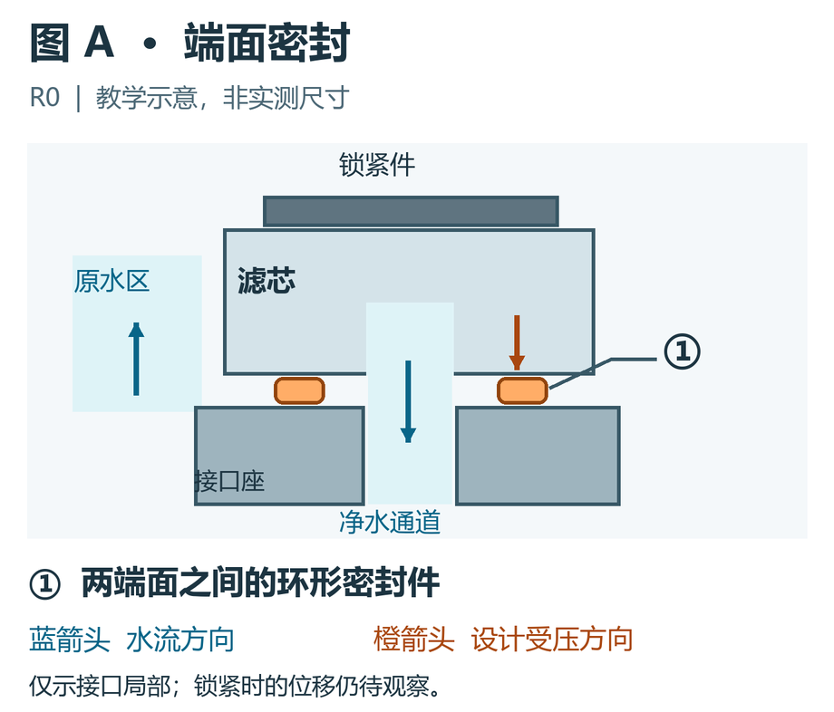
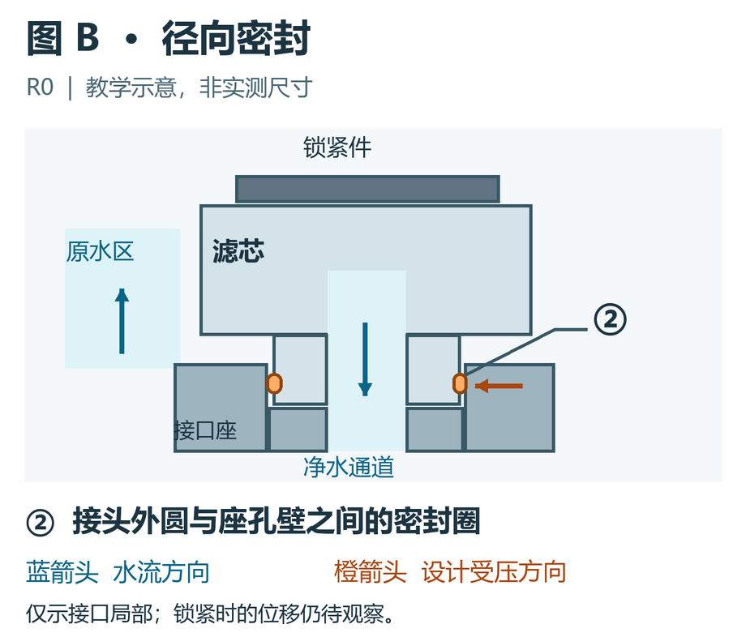

# 三类读者的专利报告模板使用说明

编制日期：2026年11月17日。适用对象：企业内部专利分析团队、研发项目组，以及受托提供专利分析服务的机构。

这套材料用于把专利研究转化为经营选择、研发任务和知识产权行动。三份模板可以分别使用；若用于同一个项目，应共用产品版本、数据截止日和证据底稿。模板是根据标准、指南与公开报告设计的工作文档，不是上述机构发布或认证的模板。

教学示例以台式即热饮水设备的可拆卸滤芯接口为对象，假设目标市场为中国和德国。近期部分处于样机制作前。储备部分讨论下一代产品更换滤芯时自动切断原水的设想。所有示例数字、权项和试验条件均为教学假设。

## 选择哪一份模板

| 模板 | 主要使用场景 | 阅读后应能完成的事情 |
|---|---|---|
| [企业决策者模板](01-企业决策者-专利报告模板.md) | 新业务进入、产品开发投入、自研与合作或引进方式选择 | 比较可选方案，决定本阶段投什么、投到哪一步、何时调整 |
| [研发总监模板](02-研发总监-专利报告模板.md) | 研发立项、路线选择、在研项目复盘和方案优化 | 解释技术差异，选择验证任务，安排人员及阶段评审 |
| [专利总监模板](03-专利总监-专利报告模板.md) | 业务相关专利风险排查、布局、组合管理和预算分配 | 确定权利核查、保护与处置任务及其优先级 |

三份文件都提供每部分要回答的问题、证据字段、分析方法、可填写正文和具体示例。新项目可从网页的“下载空白稿”开始填写，或使用离线包内的“空白稿”文件夹。方括号中的内容需替换。表格中的示例行与空白填写行应分开处理；交付正式报告前删除所有教学数据。

## 同一组发现，怎样向三类读者表达

三份摘要都引用下方[结构比较示例](#结构比较示例)中的 DEMO-C-001。以下三段采用同一个教学假设：A/B的结构不同，但尚无同工况试验；相关权利也未完成核查。它们共用事实，只改变需要作出的决定。

| 读者 | 正文表达示例（全部为模拟） |
|---|---|
| 企业决策者 | 建议先批准8周、30万元的验证与核查预算。本阶段要回答两条路线能否满足使用要求，以及自研、合作或许可各有什么成本和约束。现有证据支持继续调查；是否投入量产，待技术、权利和经济性三项条件确认后再决定。 |
| 研发总监 | A依赖轴向压紧量，B依赖径向密封压缩量，两者可能有不同的公差与装配失效方式。先核实接口实际温度和压差，再用相同检测方法比较内部旁通、外漏和拆装表现。目前没有可比数据，暂不收敛路线。 |
| 专利总监 | 图 A 显示端面密封这一结构线索。锁紧件是否使滤芯沿轴向移动并将端面环形密封件抵压在接口座端面上，仍待核对装配动作。请先取得目标辖区的当前权项和状态记录，并完成逐特征对照。B的结构差异及其他相关权利仍需核查。本阶段安排证据补齐与专业复核，下一关卡按产品版本和国家分别评审。 |

建议先填共用底稿，再完成各模板的分析模块，最后写首页决策摘要。压缩汇报时保留摘要、决定所需的关键图表和行动表；完整证据留在可直接访问的附件中。

## 共同教学案例的边界

案例对象为“台式即热饮水设备的可拆卸滤芯接口”，目标市场假设为中国和德国。全部 DEMO 标识均为虚构教学材料，不是真实专利、客户、试验或法律意见。

| 项目 | 共同设定 |
|---|---|
| 业务问题 | 是否进入该业务，以及所需技术采用自研、合作还是许可引进 |
| 技术路线A | 借轴向压紧使滤芯接口端面的密封件形成密封 |
| 技术路线B | 使接口套接，通过径向受压的密封件形成密封 |
| 需先确认的系统条件 | 滤芯与加热部件的相对位置、流向、回流与导热路径。设备“即热”不证明滤芯接口必然承受热水；只有接口实际温度历程支持时，才采用相应温度循环试验 |
| 项目阶段 | 概念与样机验证前评审。A/B均待验证，不预设量产路线 |
| 本阶段示例预算 | 8周，上限30万元：工程验证20万元、专利及许可核查8万元、预备2万元；均为教学假设，不是行业报价，不包含量产投资 |
| 阶段建议 | 可建议批准限额验证；不得据此写成量产、销售或特定市场的自由实施已获确认 |
| 数据关系 | 企业版用 DEMO-E-，专利版用 DEMO-IP-，旧号对应表在这两份模板文末。研发版的模拟试验不设证据编号。真实项目使用同一组唯一证据ID，不能按角色另造事实 |

各文件的示例用于演示如何写出有证据条件的判断，不构成对该类设备市场、结构性能或专利风险的实际评估。

## 一套底稿支撑三份报告

下面四张表可以直接复制到项目附件中。正文用证据编号和定位引用，附件保存原文、截图、设计或数据文件。保留“为什么相关”这一列，防止有链接却不能支撑判断。

### 结构比较示例

两张图采用相同的示意比例和观察方向，展示滤芯下端与接口座的局部剖面。蓝箭头表示水在各自通道中的方向，橙箭头表示密封件的设计受压方向。座和滤芯的相对位置可比，图上没有实测尺寸。外密封、滤材回路和加热部件位于本图范围以外；实际热路径待查。

先看图 A 的 ①，密封件夹在两个端面之间。再看图 B 的 ②，密封圈夹在接头外圆与座孔壁之间。两图画的是装配后的结构，没有记录是谁使滤芯移动，也没有测出旁通或外漏。

### 表A 证据登记与使用边界

| 证据编号 | 来源类型与标题 | 原始发布者/持有人 | 文献或文件版本 | 原文定位 | 获取及核查日期 | 支持哪项事实 | 尚不能支持什么 | 保存位置与复核人 |
|---|---|---|---|---|---|---|---|---|
| [E-001] | [专利授权文本/设计图/试验记录/客户访谈/官方登记簿等] | [填写] | [公开或授权版本、图纸版本等] | [权利要求号、段落、附图、页码或数据行] | [YYYY-MM-DD] | [限定范围内的事实] | [推断边界] | [文件路径或链接；姓名] |
| DEMO-E-001（教学图 A） | 路线 A 接口剖面 | 模板编写组绘制 | R0 | 图 A ①，滤芯下端与座端面之间 | 教学评审日 | 环形密封件位于两个相对端面之间，设计受压方向沿轴线 | 锁紧时是否移动、接触压力和密封性能均待查 | 随包 figures/section-a.png |
| DEMO-E-002（教学图 B） | 路线 B 接口剖面 | 模板编写组绘制 | R0 | 图 B ②，插接段外圆与座孔壁之间 | 教学评审日 | 外圆槽内的密封圈与座孔壁接触，设计受压方向沿半径 | 锁紧件是否进一步推移滤芯、有无其他密封、密封性能均待查 | 随包 figures/section-b.png |

来源可靠性、文献内容明确程度、分析推断强度是不同事项。官方专利文本能证明披露内容，但文本中的效果记载不自动证明某个实物在本项目工况下达到该效果。

### 表B 结论与证据对应

| 结论编号 | 结论及适用对象 | 直接事实 | 分析推理 | 相反证据或替代解释 | 未决事项 | 可采取的行动 | 哪种新证据会改变结论 |
|---|---|---|---|---|---|---|---|
| [C-001] | [产品版本、市场、时间范围] | [证据编号与定位] | [说明中间判断，不只写“综合分析”] | [有则列明；未检查则注明] | [缺什么] | [当前证据足以支持的步骤] | [具体触发条件] |
| DEMO-C-001（教学比较） | A、B 的内部密封位置和设计受压方向不同，两条路线均保留到比较验证 | DEMO-E-001 图 A ① 的密封件设计为沿轴向压紧；DEMO-E-002 图 B ② 的密封圈设计为在接头外圆处沿径向受压 | 装配误差可能以不同方式改变压缩量，性能差异待验证 | 材料、公差或实际工况也可能影响表现 | 截至教学评审日，本例资料清单仅含上述两张 R0 图，未提供同工况试验记录 | 见表 D 的结构补证及同工况比较任务 | 可复核的装配记录或同工况结果支持更新相应判断 |

### 表C 检索与数据处理记录

| 事项 | 必填内容 |
|---|---|
| 任务与边界 | [本次支持什么决策；产品、技术、国家、语言、时间范围；排除内容及原因] |
| 数据源 | [数据库名称、覆盖特点、检索日；法律状态所用登记来源另列] |
| 检索策略 | [关键词及同义词、分类号、申请人、引证追踪；完整检索式与迭代记录位置] |
| 筛选 | [纳入/排除规则，初始命中数、排除数与原因、最终分析量；保留样例] |
| 去重与统计单位 | [公开件/申请件/专利族；采用的同族定义；统计年字段；分案、继续申请及多国成员如何处理] |
| 申请主体归并 | [集团/子公司/曾用名归并规则；归并时点和依据；不能确认的主体] |
| 分类与阅读深度 | [分类定义；人工复核规则；哪些只读题录摘要，哪些读说明书和附图，哪些核对授权权利要求] |
| 质量检查 | [已知重要文献回检、相邻分类与同义词补检、抽样复核结果；如称查准率，列分子/分母和抽样方法] |
| 不可见范围 | [未公开申请、数据库覆盖缺口、全文缺失、翻译或名称误差、状态更新滞后] |
| 可重现附件 | [清洗后的数据、分类字典、计算口径、图表数据与原始记录保存位置] |

没有完整真值集合时，不填写一个未经证明的“查全率”。可报告已知样本回检覆盖情况和补检结果，并明确它们不能证明所有相关专利均已检出。

### 表D 补证与行动安排

| 未决问题 | 为什么影响决策 | 需要的具体材料或验证 | 提供/执行人 | 截止时间 | 验收条件 | 未解决时的项目处理 |
|---|---|---|---|---|---|---|
| [问题] | [会改变哪项选择] | [文件/样机/数据及范围] | [责任人] | [日期或阶段] | [可观察的完成标准] | [延期、缩小范围、保留路线或停止某项投入] |
| DEMO-C-001 · 锁紧动作由谁造成？ | 决定知产逐项对照能否继续 | 对 A、B 分别用同一固定基准记录插入结束、开始锁紧、锁紧完成时的位置和接触状态；附图或连续动作记录 | 结构工程师提供，专利负责人复核 | 逐项对照评审前 | 能区分插入引起的移动和锁紧引起的移动，缺项逐一标待查 | 保留对应线索，暂缓对动作限定作结论 |
| DEMO-C-001 · 两种结构在相同条件下表现怎样？ | 决定是否有依据收敛路线 | 先核实接口温度、压差和公差，再按共同条件分别记录每件样品的内部旁通、机外泄漏与拆装表现 | 测试负责人执行，研发负责人复核 | 两条路线比较评审前 | 有可比工况、样品版本、原始记录和异常说明，分别报告各指标 | 缺少可比记录时保留两条路线，性能排名待定 |

## 阅读者看到的正文怎样组织

每一项重点判断建议按以下顺序写成完整段落：

> 对于[对象与条件]，当前建议[行动]。依据是[具体事实及编号]。这些事实支持[中间判断]，但尚未解决[关键缺口]。因此本阶段可进行[允许推进的步骤]；在[期限]前，由[责任人]补充[证据]，达到[条件]后再决定[下一步]。

这是一种写作辅助，不要求每段机械重复同一句式。正文应先让读者理解产品和问题，再介绍足以影响决策的技术或权利事实。图表标题应点明发现，图下注明计数单位、范围、时间和解释限制。

## 如何确认一份填写后的报告可以交付

- 读者能明确说出本次需要作出的决定，而不只是复述专利数量。
- 每个关键判断均有对应证据和原文定位；反例、缺失信息与假设没有混入已核实事实。
- 技术比较采用可比的工况、指标与样本口径；专利记载、工程推断和项目实测分别标明。
- 风险判断限定到产品版本、具体国家、相关权利和时点；没有用相似性分数代替法律分析。
- 建议能落到负责人、预算范围、交付物、时间及继续/停止条件；数字能够回查或重算。
- 管理摘要与详细正文使用同一版本证据，更新一项关键事实时能同步修改相关结论。
- 已删除所有 DEMO 教学材料；未解决事项被列入补证表，而非空白或默认通过。

来源阅读范围、原文页码及本次模板如何吸收这些方法，见[重点资料阅读与设计依据](04-重点资料阅读与设计依据.md)。

## 文件包内容

可编辑文件包包含本说明、三份模板、重点资料说明和三份阅读笔记，共8份Markdown文档。文件可直接复制到Word或团队文档中继续填写。原始资料保留官方链接；为便于转交，压缩包不包含本地原文、逐页文字和核读图片。阅读笔记中以 `sources/` 开头的文件名是本次研究留档索引，不是压缩包内附件。

## 近期预研与中长期储备怎样选择

近期预研围绕已明确项目，回答下一次评审还缺什么证据；中长期储备判断未来需求、技术选项或能力是否值得保留。两者都需要负责人和资源安排，不以固定年限划分；8周只是案例工期。

- 企业决策者：近期看本次授权与投入边界；储备看保留理由、机会成本和改变投入的信号。
- 研发总监：近期看可比试验与路线取舍；储备看机制认识、依赖条件和最小研究。
- 专利总监：近期看产品与具体权利的待核事项；储备看未来用途、组合覆盖及布局/维持理由。

### 共用储备卡S-01（模拟示例）

本卡的共同假设为“下一代产品可能需要在解锁滤芯时联动切断原水”。目前仅是设想；没有真实需求、专利、图纸或试验资料，所有真实证据编号保持“未取得”。三个角色的中长期储备模块分别解释经营、研发与权利意义，不能提高这一证据状态。

| 必须填写 | 怎样填写 |
|---|---|
| 对象与理由 | [具体问题、未来使用情境、保留理由与替代方案] |
| 证据状态与反证 | [逐判断记录设想/有信号/机制有条件支持/已有初步验证；来源、位置、版本、核验状态及推翻条件] |
| 关联与最小交付 | [近期模块、共同证据ID；最低研究任务与可复核成果] |
| 责任与资源 | [负责人、人日、预算上限、估算依据、费用归属、批准人及状态] |
| 复核安排 | [下次日期/周期及理由；需求、技术、供应或权利变化等事件触发] |
| 转入近期或关闭 | [需要什么证据及谁批准；核对其他产品和合同依赖] |

储备可占用本期预算，须清楚记录分摊；即使今后 A 或 B 通过近期验证，也需单独评审这项储备。需求经确认不成立且无其他产品或合同依赖时，再评估关闭。成果可以是理解机制或排除错误解释，不强制形成投资决定。

## 本页与专利棱镜的关系

本页提供专利研究与决策报告的写作模板及教学示例，不执行检索或核验。专利棱镜用于开展证据研究、技术解释、路线比较与多角色解读，也允许交付理解技术、排除解释和缩小不确定性等研究成果。

棱镜成果可以作为填写材料，但要保留来源、版本、核验状态和适用范围，并补充本项目的图纸、需求、试验及资源依据。三角色入口不意味着三套互不相干的事实；填完表格也不等于完成研究或取得法律意见。
