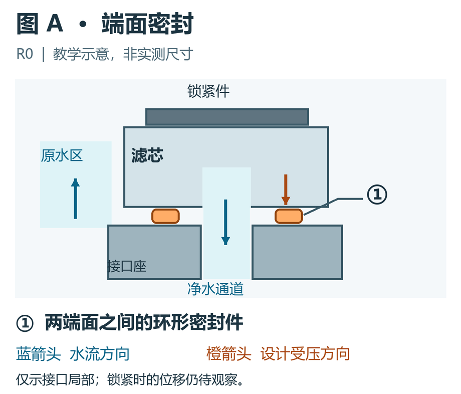
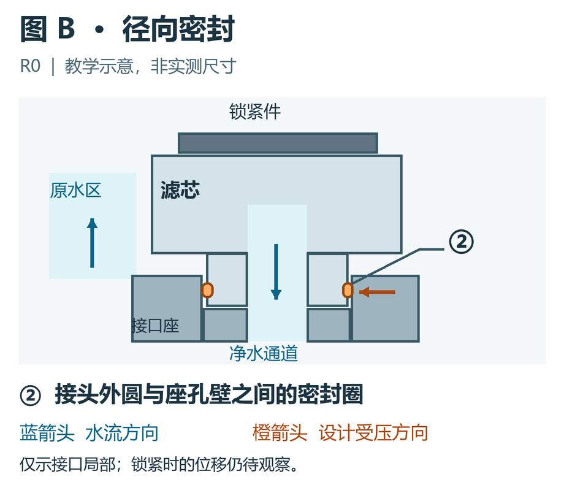

# 研发总监用专利报告模板

用途：研发立项评审、技术路线选择、在研方案优化及阶段复盘。完成后，读者应能判断“为什么做、现阶段做得成什么、路线之间怎样取舍、先验证什么、何时继续或停止”。

这是依据已读资料编制的工作模板，不是国家标准原文，也不表示填完表格即可满足全部标准要求。GB/T 39551.5—2020 的立项评价与研发过程辅助是本模板的两个使用场景；模板中的试验门槛、预算和教学结构均由本次编制，不能归因于标准或案例报告。

报告名称：[项目／产品／技术范围]；版本：[ ]；评审日期：[ ]；资料截止日：[ ]；项目阶段：[拟立项／概念／样机／验证／量产变更]；编制：[ ]；技术复核：[ ]；专利复核：[ ]；审批：[ ]。

**阅读提示：**近期预研围绕当前项目补齐下一关卡证据；中长期储备关注值得保留的问题、技术选项和能力，两者不按固定年限划分。8周仅为教学工期。

**先理解两个词：**“旁通”是水绕过预定滤材路径而进入净水侧；“外漏”是水流向机器外部。旁通比例是前一种流量占净水侧总流量的比例，测量方法须排除滤材吸附等干扰。

**教学示例。**本文件的模拟试验不设证据编号。引用共用底稿的结构图和比较结论时，沿用其图号和结论编号；引用企业或知产材料时保留该文件的教学编号。真实项目的证据编号跨角色共用，同时保留来源、版本与核验状态。

## 使用方法与统一教学案例

将方括号替换为真实项目资料；删除所有教学示例后再对外使用。资料缺失时保留“未取得／待验证”，不要填零或编造结论。文中章节号、标准号和来源页码是定位信息；**所有教学案例的参数、金额、周期、样本安排和目标值均为“模拟 DEMO”，不是实测、企业承诺、法定限值或真实专利结论。**

本模板统一使用以下假想产品：拟在中国和德国销售的台式即热饮水设备，可拆卸滤芯竖直放入固定底座。原水位于滤材外侧的进水腔，穿过滤材后进入中心净水通道，再经滤芯下端出水口进入底座净水孔。内部隔水密封用于阻止原水绕过滤材进入净水通道；防止水流向机外的外部密封单独设计，在两条路线中保持相同。

- **路线 A：轴向压紧端面密封。**环形密封垫位于滤芯下端出口的环形端面与底座环形承压面之间；设计意图是由上方锁紧件沿滤芯轴线向下施力，让两个端面夹住密封垫；实际位移和接触状态仍需观察。密封接触压力依赖锁紧件、轴向尺寸链及密封垫变形。
- **路线 B：径向密封套接。**滤芯下端圆柱出水接头向下插入底座圆孔；密封圈装在接头外圆槽内，设计上由圆孔内壁沿径向压缩，实际压缩量待测。锁紧件的设计用途主要是限制轴向退出；密封压缩量主要由孔径、槽尺寸和密封圈截面共同决定，不能由“已经锁住”推定密封足够。

**热负荷前提（模拟 DEMO）：**为演示热循环分析，假定相邻加热单元可能经底座传热，使接口温度随启停变化。尚未确认传热幅值，也未假定热水必然流经过滤接口。真实项目先核对水路、回流路径、隔热结构并测量接口温度；若滤芯始终位于常温前置水路，试验条件必须按真实使用和异常工况重新确定。

**共同阶段条件（模拟 DEMO）：**概念／样机前评审；第一阶段为 8 周、总费用上限 30 万元，其中工程验证 20 万元、专利及许可核查 8 万元、预备费用 2 万元，不含量产。A、B 均待验证，不能在没有证据时推荐定型。

每条关键结论在句首标明证据性质：**【原文披露】**仅限已读原文确实记载的内容，附文献和位置；**【工程推断】**写清前提和推导；**【实测】**连接原始记录、样品和条件；**【模拟 DEMO】**表示教学假设。专利说明书自述效果仍属于原文披露，不自动升级为本项目实测。

## 模块一：本次评审需要作出什么研发决定

### 回答的问题

立项场景：需求是否值得解决，本企业为何现在做，什么条件下可以立项？在研场景：原目标是否改变，出现了什么新证据，本次需要继续、调整还是停止哪项工作？

### 证据输入与最低字段

**填写起点。**先分别确认需求、现有能力和本轮请求的动作。

**完整证据清单：**

- 输入经批准的产品需求、用户场景和售后记录、市场与渠道资料、当前项目方案、政策及适用要求清单、项目计划。
- 至少记录：目标用户、使用任务、主要痛点及来源、目标市场、产品差异化、现有替代方案、拟解决的技术问题、项目阶段、已有成果、未解决障碍、请求决策、费用范围、截止时间。
- 产业或市场信息应有日期和来源，不能从专利数量推算销量或利润。

**缺项如何处理。**售后样本或真实使用情境缺失时，只能提出结构问题。产品负责人应在立项评审前核对需求。

### 分析及表达方法

先写本次需要批准的具体动作，再解释必要性和可行性。分别列“需求证据”“能力证据”“尚缺证据”，避免一句“市场前景广阔、技术成熟”同时替代三项判断。立项报告必须有产业环境、技术环境、技术壁垒、主体市场实力与技术储备的综合判断；在研报告增加上次评审以来的变化。

### 可填写骨架

| 项目 | 填写内容 |
|---|---|
| 本次需要决定 | [批准什么范围／暂缓什么／补什么证据] |
| 需要解决的用户问题 | [对象、场景、现象、影响、来源] |
| 为什么不能直接沿用现有方案 | [性能／成本／维护／供应／权利障碍及证据] |
| 立项必要性／继续研发价值 | [需求强度、业务匹配、时间窗口及不确定性] |
| 当前可行性 | [已有能力、缺口、获取方式、首阶段能证明什么] |
| 此次批准边界 | [人员、费用、周期、交付物、退出条件] |

### 具体示例（模拟 DEMO）

> 建议只批准可拆卸滤芯接口的概念验证阶段，保留 A、B 两条路线。要解决的问题是更换滤芯后原水与净水通道能否持续隔离，以及用户是否容易装到正确位置。当前尚无旁通率、热循环后尺寸变化和装配力的有效对比数据，不能据结构简洁程度选择量产方案。
>
> 第一阶段在模拟 8 周、30 万元上限内完成接口温度测量、同条件样件对比和中国／德国相关权利核查；阶段末再决定收敛路线或停止。

本页对 A、B 的结构判断沿用共用底稿。[查看两张教学剖面图和共用结论 DEMO-C-001](00-使用说明与证据底稿.md#结构比较示例)。

### 这段结论的使用边界

A、B均待验证；没有同条件数据不能选定量产方案，商业必要性不能只靠结构问题推断。

### 资料不足时这样写

> 尚未取得[用户需求／故障样本／市场数据]，因此当前仅能说明问题在结构上值得核查，尚不足以证明商业必要性；建议将[资料收集]列为立项前提，由[负责人]在[日期]前完成。

## 模块二：本报告看了什么，哪些证据足以支撑判断

### 回答的问题

检索边界与当前研发问题是否一致？重点专利读到什么程度？能否让工程师沿着结论找到原文、附图、图纸或试验记录？

### 证据输入与最低字段

**填写起点。**先确认检索覆盖、实际阅读深度和关键证据定位。

**完整证据清单：**

- 记录数据库及版本、检索日、时间窗口、国家／语言、关键词及分类、申请人与集团归并方法、同族规则、纳入／排除理由、筛选记录、重点全文和附图、法律状态查询日期、非专利资料和内部数据。
- 趋势分析记录统计单位和日期口径；
- 实施风险按目标国家的具体权利核查，不能只保留同族代表件。

| 证据编号 | 材料类型／原始链接 | 阅读范围 | 定位 | 可支持的结论 | 不能支持的结论 | 复核人／日期 |
|---|---|---|---|---|---|---|
| [ ] | [专利全文／论文／图纸／原始试验] | [摘要／正文／权利要求／附图／补充材料] | [段落、权项、图号、页码或记录行] | [ ] | [ ] | [ ] |

**缺项如何处理。**读到摘要但未取得权项或附图时，将材料登记为线索。专利分析人员应在用它支持路线排序前回查原文。

### 分析及表达方法

先区分“供发现线索的数据集”和“供决策的重点证据集”。一族多件不能重复当作多个独立方案；一族可能同时涉及密封、锁紧和维护，分类合计因此可能超过总族数。趋势图明确分母、口径和公开滞后。对关键结构至少逐项核对说明书、权利要求和相关附图；图中看不清的关系不能凭经验补齐。检索方法与变更记录放附录，正文保留覆盖范围与影响结论的缺口。

### 可填写骨架

> 本报告覆盖[产品／部件／功能]，重点检索[地区／时间／语言／数据库]。统计使用[单位]，趋势日期按[口径]；技术内容筛选后重点阅读[数量及阅读深度]。关于[结论]的直接证据为[编号与位置]；[缺少内容]仍未取得，因此该结论只适用于[边界]。原始检索、排除记录与复核结果见[路径]。

### 具体示例（模拟 DEMO）

> 拆卸接口的检索概念覆盖滤芯连接、原净水隔离、端面密封、径向密封、锁紧定位和更换维护。某条记录即使同时标为“密封”和“快装”，也只代表同一组发明材料。尚未取得其授权权利要求时，可以记录说明书展示的装配方式，不能写成“该方案在德国可自由实施”。
>
> 本教学案例没有真实检索结果，所有实际文献编号留空。

### 这段结论的使用边界

摘要或节选只作线索；同族代表件不能代替目标国家的权利核查，公开活动受公开滞后影响。

### 资料不足时这样写

> 当前仅获得[摘要／网页摘录]，尚未读取[权利要求／附图／实验条件]；本条仅作为检索线索，不参与路线性能排序或实施风险结论。

## 模块三：把产品拆成可比较的技术问题与路线

### 回答的问题

接口由哪些部件组成、各自位于哪里？水、力和热沿什么路径传递？A、B 究竟在哪个位置、以什么方向形成密封？

### 证据输入与最低字段

**填写起点。**先画清水路、力和热的路径，再解释密封位置及动作。

**完整证据清单：**

- 输入水路图、剖视图、关键尺寸和公差、材料规格、密封供应商资料、装配动作、清洗／维护流程和相关专利附图。
- 每条路线至少写：功能、部件、相对位置、连接关系、运动／受力方向、作用条件、预期效果、失效假设、相关证据。
- 若同一专利有不同实施例，分开记录，不能拼成一个“已披露方案”。

**缺项如何处理。**图纸看不清密封位置或施力方向时，机制仍待确认。结构工程师应在出样前补剖面图或实物测量。

### 分析及表达方法

使用“功能—部件—作用关系”分解。先画同一套系统边界，再画两张同尺度剖面示意，标注原水区、净水区、内密封、外密封、锁紧件和热源。用箭头区分水流与受力，不能用同一颜色混在一起。技术分类用于组织证据，不代表所有选项互斥。

### 可填写骨架

| 需要完成的功能 | 路线与关键部件 | 位置和动作方向 | 形成效果的条件 | 证据／待验证事项 |
|---|---|---|---|---|
| [需分隔的介质或区域] | [ ] | [ ] | [ ] | [ ] |
| [需建立或维持的作用关系] | [ ] | [ ] | [ ] | [ ] |
| [操作及防错功能] | [ ] | [ ] | [ ] | [ ] |
| [需承受的工况或维护操作] | [ ] | [ ] | [ ] | [ ] |

> 路线[ ]在[位置]布置[部件]。当[工况／操作]发生时，[部件]沿[方向]作用于[另一部件]，在[满足条件]时可实现[效果]。原文只披露[内容]；本项目仍需确认[缺口]。

### 具体示例（模拟 DEMO）

图 A 的 ① 和图 B 的 ② 对应共用底稿 DEMO-E-001、DEMO-E-002。两图方向和示意比例相同。蓝箭头表示水流，橙箭头表示设计受压方向；滤材回路、外密封和热源未画入。

> A 的隔水密封垫围绕中心净水出口，夹在滤芯下端环形端面与底座环形台阶之间。图 A 的橙箭头表示密封垫预期沿轴向受压。锁紧件是否使滤芯继续下移，需要分阶段记录装配动作。图 B 的圆柱出水接头插在底座孔中，橙箭头表示外圆槽内的密封圈设计为沿径向受压。实际过盈量（装配前尺寸的重叠量）和接触压力均待测。
>
> 两者都需要把原水外腔与中心净水孔隔开；外壳是否漏水由另外的外密封控制，不能用“机外无水滴”代替对内旁通的检查。

### 这段结论的使用边界

不同实施例不能拼成一个已披露方案；机外无水滴不能证明原水未绕过滤材进入净水侧。

### 资料不足时这样写

> 现有附图没有清楚显示[密封圈槽／接触端面／水道连通]，目前只能确认[可见内容]，不能据此确定密封作用方向。需补充[剖视图／实物测量／原文实施例]。

## 模块四：竞争和技术发展对本项目有什么具体影响

### 回答的问题

技术变化集中在哪里，哪些方案或主体值得继续跟踪？现有替代路线为什么仍应保留？竞争者的信息能否改变本项目的任务安排？

### 证据输入与最低字段

**填写起点。**先确认时间、统计口径和代表性结构，再判断项目影响。

**完整证据清单：**

- 输入按同一口径整理的专利族、申请人归并、技术分支标注、重点专利内容，以及产品拆解、市场、供应链和公开试验资料。
- 最低字段：主体／分支／时间／数量及分母／关键结构／目标问题／证据强弱／与本项目关联／拟采取动作。
- 申请人所在地、发明人所在地、申请国和销售市场分开列。

**缺项如何处理。**口径或代表文献不清时，不能从数量变化认定技术迁移。专题负责人在更新技术时间表前核对原文与日期性质。

### 分析及表达方法

用“主体×技术问题”表定位竞争点，用分支随时间变化说明关注方向，并把代表性结构放在图表旁边。专利热点只表示所选数据中的申请活动；成熟度应结合样机、实测、产品和制造证据。数据稀疏处可列为候选检索方向，不能直接命名为“可专利空白”。

### 可填写骨架

| 技术问题／路线 | 主要主体及证据 | 近期变化与统计口径 | 本项目受到的影响 | 后续动作／触发条件 |
|---|---|---|---|---|
| [ ] | [ ] | [ ] | [ ] | [ ] |

> 在[范围]内，[分支]的公开活动出现[趋势]，相关结构主要针对[具体问题]。这说明[有限解释]；结合[产品／试验／市场证据]，建议本项目[动作]。尚不能据此认定[性能／销量／排他性]。

另保留一张可追溯的技术时间表，将技术变化与证据出现的时间分开：

| 事件时间及日期性质 | 路线／结构版本 | 当时解决的问题与具体变化 | 证据及原文位置 | 与前一节点的关系 | 尚未解决的问题／本项目动作 |
|---|---|---|---|---|---|
| [优先权／公开／产品发布／试验日期，分别标明] | [ ] | [部件位置、关系或动作怎样改变] | [ ] | [原文明确关联／有引证线索／仅时间相邻] | [ ] |

例如，可依次列出“出现径向密封方案”“加入插入导向”“增加解锁前止水”的待核节点，但每个节点都须取得真实文献和日期后才落图。时间先后或文本相似不能单独证明技术继承关系；专利公开日期也不能自动当作技术首次出现或产品成熟的日期。

### 具体示例（模拟 DEMO）

> 如果后续检索发现多家企业在径向密封接口增加导入段和限位结构，应逐件确认它们是否针对密封圈刮伤、偏斜或插入深度问题。研发上的直接任务是检查 B 路线的导向长度、孔口毛刺和装配偏心，而不是据此宣称 B 比 A 先进。A 仍保留，用同样的内旁通、拆装和寿命要求比较。
>
> 当前没有真实检索数据，不能填写主体排名或增长率。

### 这段结论的使用边界

时间相邻不证明继承；申请热点不证明成熟度，技术时间表须保留真实来源和日期性质。

### 资料不足时这样写

> 近期数据受[公开滞后／样本不足／归并不完整]影响，所示变化还不能确定为技术转移。建议以[代表文献核读／产品验证／后续更新]补充后再调整研发方向。

## 模块五：在同一工况下比较路线与因果关系

### 回答的问题

哪条路线有望解决哪些问题，又引入什么代价？差异来自结构，还是来自材料、尺寸或试验条件不一致？

### 证据输入与最低字段

**填写起点。**先确认A、B工况与样品可比，再判断结构差异。

**完整证据清单：**

- 输入相同版本的产品要求、设计图、材料、尺寸实测、表面质量、供应商能力、成本假设和试验记录。
- 对比必须列：样品状态、密封材料及硬度、温度、压差、流量、污染／清洁状态、装配公差、装配方法、循环条件、检测方法和统计方式。
- 不能在不同工况下把论文数值或专利自述效果直接拼入同一排名。

**缺项如何处理。**A、B的材料或工况不同，先分开列结果。测试负责人在路线评审前补做相同条件的对照。

### 分析及表达方法

先列硬约束，再比较收益与代价。把“原文效果”“工程推断”“本项目实测”分列；没有实测时输出待验证假设，不算综合胜负分。若采用加权评分，先解释门槛、指标方向和权重来源，并检查权重改变后结论是否反转。

### 可填写骨架

共同边界：[水路与热路径]；共同工况：[温度／压差／流量／循环／装配状态]；允许不同之处：[仅密封实现与必要配套结构]；暂未控制的变量：[ ]。

| 评价维度 | A 的机制与代价 | B 的机制与代价 | 当前证据性质 | 怎么检验／通过条件 |
|---|---|---|---|---|
| 内旁通 | [ ] | [ ] | [ ] | [ ] |
| 外漏 | [ ] | [ ] | [ ] | [ ] |
| 热循环后接触保持 | [ ] | [ ] | [ ] | [ ] |
| 装配、公差与误装 | [ ] | [ ] | [ ] | [ ] |
| 拆装、清洁与维护 | [ ] | [ ] | [ ] | [ ] |
| 制造、供应与成本 | [ ] | [ ] | [ ] | [ ] |

### 具体示例（模拟 DEMO；以下均为工程推断，非观察到的故障）

| 条件 | A 的待验证假设 | B 的待验证假设 | 必须保留的反例 |
|---|---|---|---|
| 原水侧压力高于净水侧 | 若端面未压紧或有异物，局部间隙可能连通原净水腔 | 若径向压缩不足或密封圈受损，接头外侧可能形成旁通路径 | 密封材料、公差和表面质量足够时，两者都可能满足要求 |
| 接口真实承受温度循环 | 不同材料热变形与应力松弛可能改变轴向压紧量 | 孔、接头和密封圈的热变形可能改变径向压缩与摩擦 | 没有实际温度和尺寸测量，不能断言哪条更耐热 |
| 用户向下装入滤芯 | 压紧行程不足时，锁紧外观可能与有效压缩不一致 | 插入时孔口可能刮擦或扭转密封圈，需验证导向与表面状态 | 改进限位／导向可能改变比较结果，必须更新版本后复测 |

> 本轮不宣布优胜路线。先分别核查 A 的轴向尺寸链与压紧保持、B 的径向尺寸链与插装损伤，再以共同边界测试。修改后的 A 或 B 应作为新版本记录，不能把改前和改后样品混为同一组。

### 这段结论的使用边界

全部机制示例均为待验证工程推断；保留两条路线都可能满足要求的反例，改版样品不可与旧版混组。

### 资料不足时这样写

> A 的数据来自[条件]，B 的数据来自[不同条件]，目前不具备直接比较基础。只能列出各自已知结果，暂不作性能排名；由[负责人]补齐共同工况试验。

## 模块六：专利约束怎样转成研发动作与候选改进

### 回答的问题

拟采用的部件组合涉及哪些权利问题？哪些可调整特征值得做替代样件？改变结构会怎样影响技术效果和新的申请机会？

### 证据输入与最低字段

**填写起点。**先确认产品版本与具体权项的对应，再提出候选改进。

**完整证据清单：**

- 输入目标产品图纸版本、中国和德国相关权利文本、公开及授权版本、法律状态及查询日、逐特征比对、相关历史文献和内部研发记录。
- 最低字段：目标市场、具体权利、产品对应部位、特征对应证据、不确定点、研发替代方案、工程代价、待核法律事项、负责人。
- 技术学习范围与产品实施风险范围分别界定。

**缺项如何处理。**没有目标辖区授权文本或对应产品图纸时，仅列结构约束线索。专利与研发负责人在样机设计冻结前完成对照。

### 分析及表达方法

研发正文只保留对结构选择有影响的风险和动作，完整权利比对另附。发现一个不同特征，只能提出核查方向，不能直接写“已规避”。可专利性、实施自由和工程可行性分别判断。每项候选改进都写“想解决的问题—改变的结构关系—预期作用—代价—验证与检索任务”。

### 可填写骨架

| 产品特征／版本 | 相关权利及国家 | 对应内容与不确定点 | 候选研发调整 | 工程影响 | 复核／验证负责人及期限 |
|---|---|---|---|---|---|
| [ ] | [真实文献号／状态／查询日] | [权项、图纸位置、需解释内容] | [ ] | [ ] | [ ] |

| 候选改进 | 技术问题 | 结构关系与作用条件 | 预期效果及证据层级 | 现有技术／法律核查 | 试验任务 |
|---|---|---|---|---|---|
| [ ] | [ ] | [ ] | [ ] | [ ] | [ ] |

### 具体示例（模拟 DEMO）

> 若真实权利比对显示某种“旋转锁紧与轴向压紧的组合关系”需要重点核查，研发可提出独立锁紧件、独立压紧结构或其他装配关系作为候选。改动后仍需确认受力路径是否稳定、用户是否会漏装，以及原水是否可能进入净水通道。
>
> 这里没有真实权利文件，不能称某候选方案已避开权利范围；中国与德国的判断也不能相互代替。针对 B 增加导入结构属于待检索的改进思路，不自动成为可申请发明。

### 这段结论的使用边界

一个不同特征不等于已规避；可专利性、实施风险与工程可行性分别核查，中国与德国结论不能互代。

### 资料不足时这样写

> 当前缺少[授权文本／国家状态／最终图纸]，本项仅为研发约束线索。暂不能作无侵权或可授权判断；在[样机冻结／上市]前由[专利负责人]完成相应核查。

## 模块七：本企业做得成吗，哪些能力需要外部获得

### 回答的问题

项目与现有产品和市场位置是否匹配？本企业真正掌握的技术、制造和测试能力有哪些？自研、合作、采购或许可各自需要什么前提？

### 证据输入与最低字段

**填写起点。**先用同条件数据证明能力，再安排内部与外部任务。

**完整证据清单：**

- 输入主营产品、目标市场覆盖、市场份额的统计口径、营收与渠道资料、研发人员能力、已有专利及技术储备、量产经验、设备清单、供应商证据、合作／许可条件。
- 最低字段：能力项、现有水平及证据、与本项目差距、补齐方式、负责人、依赖、费用和周期。
- 专利数量不能证明加工精度、测量能力或量产良率。

**缺项如何处理。**供应商只有能力介绍时，列为候选资源。工程负责人在排入项目计划前取得同条件样件或过程记录。

### 分析及表达方法

按“需求—现有能力—缺口—获得路径”对应，不写泛泛 SWOT。区分本企业已掌握、供应商声称、样件证明和量产证明。外部主体的专利与技术方向可用于筛选候选，但合作意愿、可用产能和授权范围须另行确认。

### 可填写骨架

| 能力／资源 | 本企业已有证据 | 本项目要求及差距 | 自研／采购／合作／许可选择 | 达成条件 | 责任人／时间 |
|---|---|---|---|---|---|
| 目标市场和服务能力 | [ ] | [ ] | [ ] | [ ] | [ ] |
| 密封设计与公差分析 | [ ] | [ ] | [ ] | [ ] | [ ] |
| 模具／加工与尺寸控制 | [ ] | [ ] | [ ] | [ ] | [ ] |
| 内旁通与热循环检测 | [ ] | [ ] | [ ] | [ ] | [ ] |
| 关键专利／技术经验 | [ ] | [ ] | [ ] | [ ] | [ ] |

> 研发立项的可行性结论为[有条件可行／暂不充分／不建议]，依据是[能力证据]。尚缺[能力]，拟通过[方式]获得；若[条件]不能达成，则[调整范围／暂停]。

### 具体示例（模拟 DEMO）

> 假设本企业已有注塑底座开发经验，但尚未建立原水进入净水侧的旁通检测方法。则首阶段的瓶颈不只是选择密封结构，还包括建立可区分滤材穿透与接口旁通的测试装置。可由内部结构团队负责 A、B 的尺寸链和样件，委托具备相关测量能力的实验室共同确认检测方法。
>
> 此处不预设已有市场份额、德国服务网络或供应商承诺，相关字段均须用真实资料补齐。

### 这段结论的使用边界

供应商介绍不等于已具备能力；专利数量不证明加工精度、测量能力或量产良率。

### 资料不足时这样写

> [主体／供应商]仅提供了能力介绍，尚无相同材料、尺寸和工况下的样件或过程数据。当前只能将其列为候选资源，不能把该能力计入已具备条件。

## 模块八：用什么试验消除不确定性，怎样判定继续

### 回答的问题

最影响决策的假设是什么？怎样测、指标从哪里来、达到什么才算通过？失败时是否能区分结构、材料、公差或试验方法的问题？

### 证据输入与最低字段

**填写起点。**先确认适用工况与测量方法，再比较样件。

**完整证据清单：**

- **工况依据。**保存已批准的产品要求、真实温度和压力记录、材料适用范围、图纸版本与公差。
- **试验设计。**写清待验证假设、测量指标（因变量）、控制变量、样本来源与覆盖范围。
- **测量能力。**列出方法、仪器、检出限、条件及原始记录位置。约定异常处理方法。
- **判定与交付。**写明指标来源、门槛及审批人、负责人、计划日期、输出与下一步。法规或标准要求注明版本和条款，内部暂定目标标“待批准”。

**缺项如何处理。**未测接口温度，先测热路径，再定加载范围。未确认旁通检测能力，测试负责人先验证方法。两项缺口关闭前，不能给两条路线排性能名次。

### 分析及表达方法

先验证测量方法，再比较样件；区分旁通、外漏与滤材本身的穿透。可用隔离接口的夹具或经验证的示踪方法，但应确认示踪物是否被滤材吸附，以及采样位置和流量是否可比。记录每个样品的原始结果和失效模式，不只给平均数。样本数量须与风险、变差和验证目标相匹配，探索性试验不能外推全寿命可靠性。

### 可填写骨架

| 待验证假设 | 方法与共同条件 | 指标／单位 | 门槛及来源／批准状态 | 样本与测量能力 | 负责人／日期 | 未通过后的动作 |
|---|---|---|---|---|---|---|
| [ ] | [ ] | [ ] | [ ] | [ ] | [ ] | [ ] |

试验记录：[样件编号／版本／材料批次／尺寸实测／仪器校准／原始数据路径／偏离项／照片／异常／复核签名]。

### 具体示例（下列全部数值均为模拟 DEMO，未实施，非标准限值）

**先确认条件。**以下全部为模拟DEMO，未实施、非标准限值。应先核实真实温度、压力、材料适用范围和寿命要求；不能因整机“即热”就认定接口流经热水。条件未确认前，不能把本段作为正式试验规范。

**第一步：循环加载。**接口温度暂设在 **20–60 °C** 之间循环，每个端点停留 **10 min**，共 **500 次**。加载时原水侧表压 **0.20 MPa**、净水侧表压 **0.02 MPa**，即差压 **0.18 MPa**。

**第二步：另行检测旁通。**把共同夹具流量暂设为 **1.5 L/min**，记录实际两端压力。如果该流量与上述差压在夹具上不能同时成立，不得把二者同时作为控制目标。A、B均采用相同的加载阶段和检测阶段。

**再检查样本是否足够。**下面的安排只用于发现机制和改进方法，不能证明全寿命可靠性。

探索样件暂按每路线 **6 件（模拟 DEMO）**安排，分别覆盖名义尺寸和预先定义的密封压缩不利公差组合，各 **3 件（模拟 DEMO）**；具体边界须由尺寸链确定，不可把所有极限尺寸任意拼接。

样件编号、材料批次和装配顺序留存，A/B 的测试顺序交错，初始与循环后使用同一方法配对比较。该样本安排只用于发现机制和改进方法，不足以直接证明全寿命可靠性；正式样本量与统计要求另行批准。

| 试验任务（模拟 DEMO） | 检测与门槛示例（均待批准） | 指标来源应如何落实 | 责任人角色与交付 |
|---|---|---|---|
| 真实热路径确认 | 记录接口与邻近热源随启停的温度曲线；尚不设温度合格线 | 系统水路／热路径、传感器布置与真实使用任务 | 系统工程师；温度记录及适用试验条件 |
| 内旁通方法建立 | 校准后方法检出限目标为 **0.1%**；旁通比例目标不超过 **0.5%** | 将产品净化目标分解为允许旁通量；方法组验证误差与滤材影响 | 测试工程师；方法确认、原始数据及不确定性 |
| 外漏检查 | 在称量检出限 **0.1 g/10 min** 下未检出外漏；不能写绝对零泄漏 | 产品允许泄漏要求及夹具背景蒸发／残水校正 | 可靠性工程师；逐样品记录 |
| 装配和更换 | 暂定最大插入力不超过 **60 N**；同时记录卡滞、密封圈翻转和误锁 | 用户操作能力、姿态与接近空间，不由专利自述代定 | 结构及用户研究负责人；装配曲线与观察记录 |
| 循环后的比较 | 复测同一批样件的内旁通、外漏、装配力与尺寸变化 | 与初始值、批准门槛及误差比较 | 可靠性工程师；前后配对数据及失效分析 |

> 旁通比例必须先定义：在适用方法下，未经预定滤材路径而到达净水侧的流量，占净水侧总流量的比例。若示踪物会被滤材部分吸附，简单使用进出浓度比可能混入滤材因素，应更换或校准方法。当前本教学案例没有样品和实测数据，A、B 结果栏均应保持“待测”，不能将上述门槛写成已达到。

### 这段结论的使用边界

数值未实施、非标准限值。加载差压0.18MPa与检测流量1.5L/min属于不同阶段，若不相容不得同时作为控制目标；探索性结果不能证明全寿命可靠性。

### 资料不足时这样写

> [门槛]目前来自内部探索假设，尚未由产品／质量负责人批准；[方法]的检出限和偏差也未确认。本轮可用于筛选失效机制，不能据此作量产放行或寿命承诺。

## 模块九：把结论变成阶段计划，并保留改变结论的条件

### 回答的问题

批准后谁做什么、花多少、何时复审？什么新证据会改变路线建议？什么时候需要停止投入或升级专利核查？

### 证据输入与最低字段

**填写起点。**先确认负责人、批准预算、排期和每次评审的证据。

**完整证据清单：**

- 输入批准预算、人员可用时间、样件和实验室排期、专利核查计划、评审纪要。
- 最低字段：任务、依赖、负责人、截止日、费用类别、交付物、通过／退出条件、变更触发、下一次评审。
- 记录方案版本、证据版本和决策版本之间的对应。

**缺项如何处理。**关键负责人或实验室档期未确认时，阶段日期是拟定安排。项目负责人在启动前取得确认并更新排期。

### 分析及表达方法

正文用阶段表和动作清单。技术门槛、专利核查和业务条件分别设门，不能用费用投入或专利申请数量代替阶段成果。每次更新写“新增证据—改变的判断—修改的动作”；持续监测应有具体对象和触发条件。

### 可填写骨架

| 阶段／时间 | 必须完成的任务 | 负责人 | 交付物与证据链接 | 继续条件 | 停止／调整条件 |
|---|---|---|---|---|---|
| [ ] | [ ] | [ ] | [ ] | [ ] | [ ] |

| 监测对象／触发事件 | 对当前路线的影响 | 更新责任人 | 需要召回的评审结论 |
|---|---|---|---|
| [新权利文本／相关状态改变／试验异常／需求改变] | [ ] | [ ] | [ ] |

### 具体示例（全部周期与费用为模拟 DEMO）

| 阶段 | 工作与责任 | 必须交付 | 决策门 |
|---|---|---|---|
| 第 1 周 | 系统、产品和专利负责人确认需求、热路径、检索与权利核查范围 | 批准需求、边界图、证据计划 | 热循环适用性和检测目标未确认，则先调整试验条件 |
| 第 2–3 周 | 结构团队完成 A、B 版本、公差分析、样件；测试团队确认旁通方法 | 图纸、材料记录、尺寸实测、方法确认 | 方法不可靠或样品不可比，暂不进入路线排名 |
| 第 4–6 周 | 可靠性团队执行共同条件试验，专利团队推进中国／德国核查 | 逐样品结果、异常记录、待核权利清单 | 出现不可接受风险时暂停相关样件并分析原因 |
| 第 7 周 | 结构、测试、质量和专利负责人交叉复核 | 原始证据与结论的对应；未闭合事项 | 关键缺口不得用综合评分掩盖 |
| 第 8 周 | 研发总监组织阶段评审 | 继续／改版／停止决定及下一阶段范围 | A、B 仍无充分可比证据时，不批准定型 |

预算上限 **30 万元（模拟 DEMO）**：工程验证 **20 万元**，专利及许可核查 **8 万元**，预备费用 **2 万元**。发生超范围验证、外部许可报价或材料改版时，应重新评估周期、预算及验证计划。此处没有预设实际许可费用或合作承诺。

> 阶段结论的合格写法是：“已完成[证据编号]，在[条件]下支持[有限结论]；因[未闭合问题]，目前批准[下一步动作]，暂缓[具体决定]。如出现[触发条件]，由[负责人]在[时间]内重新评审。”本教学案例尚未执行，因此阶段状态为“待启动验证”，A、B 均未选定。

### 这段结论的使用边界

本例尚未执行，阶段为待启动验证；A、B仍无充分可比证据时，不批准定型。

### 资料不足时这样写

> 当前缺少[负责人／批准预算／实验室排期]，计划只能作为待确认安排，不能写为已承诺交付。请在启动前补齐[事项]；未完成前不将相应节点标为已通过。

## 中长期储备：先储备哪项认识与能力

### 回答的问题

机制需要哪些部件、位置和动作才能成立？最不确定的是需求、动作顺序、材料工艺还是测量方法？最小研究能排除什么解释？

本页关联共用底稿的“储备卡S-01（模拟）”；该记录连接研发模块3、5、8。近期研究发现尚未满足立项条件的选项时，可记录为储备；储备达到本项目约定条件后，再转入近期验证，不能自动视为已立项。

### 证据输入与最低字段

机制与条件：水路与剖面草图、阀的位置、解锁动作、关阀顺序、压力与公差边界；每项标来源和核验状态。

验证与反证：已有论文、专利、试验分别登记；区分原文披露、工程推断和本项目实测，并记录可能使机制失效的条件。

每份证据记录来源、版本、原文位置、核验状态、支持什么和不能支持什么。未取得资料明确写“未取得”，不能用教学数字补齐。

### 分析及表达方法

证据状态按当前主张分别记录：**设想／有信号／机制有条件支持／已有初步验证**。这些是本模板的工作标签，不是标准成熟度等级；一个维度提高不能自动提高需求、工程或权利判断的状态。默认“设想”，只有相应证据经复核才更新。

允许阶段成果是技术理解、排除错误解释或缩小不确定性，不强制承诺量产年份或商业回报。定期回顾与事件触发并用，复核周期按变化速度、风险和保留成本确定。

### 可填写骨架

| 字段 | 填写内容 |
|---|---|
| 储备对象与关联 | [具体问题/功能；关联近期模块；共用储备卡ID] |
| 保留理由与关键假设 | [未来需求或技术条件；替代方案；什么会推翻假设] |
| 当前证据状态 | [设想/有信号/机制有条件支持/已有初步验证；逐判断说明] |
| 证据与缺口 | [真实证据ID、来源、版本、核验状态；未取得内容及影响] |
| 最小研究与交付 | [用最少工作排除什么不确定性；可以复核的成果] |
| 责任与资源 | [负责人；人日；预算上限及依据；本期/专项归属；批准状态] |
| 周期与事件复核 | [下次日期/周期及理由；提前重评的事件] |
| 转入近期/继续/关闭 | [每种选择的证据条件、审批人；其他产品与合同依赖] |

### 具体示例（全部模拟，新增储备情境）

**储备卡S-01：解锁滤芯时联动切断原水。**证据状态为“设想”。三个角色共用此假设；没有真实访谈、专利核查、图纸或样件，证据编号保持“未取得”。

先研究“解锁动作能否先关闭原水通道，再解除滤芯锁止”。需要画清原水阀、锁紧件和滤芯的相对位置，检查用户开始拔出滤芯前阀是否已经关闭，以及误操作时会怎样。当前没有图纸、样件或实测，只是待研究设想。最小任务是明确动作顺序和关键失效假设，不能据此宣称已经降低漏水率。

**本轮最小交付：**一张标出阀、锁紧件与滤芯位置的剖面草图，一张解锁与关阀顺序表，以及最可能出现动作错序的工况清单。负责人由研发总监指定的项目负责人填写；人日与预算上限、估算依据、费用归属及批准人均待确认，未确认前不写成已承诺任务。储备可使用本期预算，但应明确分摊，不重复计费。

**复核安排：**下次复核日期和周期由项目负责人按资料变化速度与成本提出、审批人确认；需求变更、结构方案变化或相关权利出现新版本时提前复核。

**继续或关闭：**若形成可核查的需求、机制与资源依据，提交转入近期验证的评审；若需求经确认不成立且无其他产品或合同依赖，再评估关闭。即使今后 A 或 B 通过近期验证，也需单独评审这项储备。

### 这段结论的使用边界

这项储备目前处于设想阶段。需求、工程与权利证据仍待取得。转入近期验证前，负责人须确认资源和评审条件。

### 资料不足时这样写

尚无原文或结构依据时，储备的是待研究问题，不是已证明可行的技术路线。 当前结论保持“待研究设想”；由[负责人]在[日期]前核实[最关键假设]，再决定继续、调整或关闭，不报告已验证效果。

## 正文交付检查

- 首页能找到本次决定、适用范围、主要证据、关键缺口和下一步。
- 立项必要性与可行性、研发主体能力和技术储备有独立证据；在研优化有明确版本与变化。
- 结构描述交代位置、方向、条件和因果；原文披露、推断、实测和模拟分开。
- 两路线有共同边界与可比工况；旁通与外漏分开；热循环有实际热路径依据。
- 趋势图说明日期、统计单位、分母、同族、归并、多标签及公开滞后。
- 法律约束连接具体国家和权利文本；未把热点、空白或分值当作侵权／授权判断。
- 每项建议都能落到验证方法、指标来源、门槛、责任人、费用和评审条件。

## 资料依据与阅读边界

1. [GB/T 39551 系列官方公开合集](https://zjamr.zhanjiang.gov.cn/attachment/0/252/252844/2046706.pdf)：本模板重点使用第 5 部分，已逐页核读合集 PDF 40–46 页；关键条款为 6.4.2–6.4.3、7.4.2–7.4.3。其对总则的引用仍需在实际项目中结合使用。
2. [EPO/IEA，Innovation in batteries and electricity storage，2020](https://iea.blob.core.windows.net/assets/77b25f20-397e-4c2f-8538-741734f6c5c3/battery_study_en.pdf)：已连续阅读全部 98 页，并查看关键图表。这里借鉴报告表达与证据组织，不使用其历史电池结论推断滤芯方案的性能。
3. [Lee 等，Using patent information for designing new product and technology，2008](https://onlinelibrary.wiley.com/doi/10.1111/j.1467-9310.2008.00509.x)：目前只取得出版商摘要；没有把其未取得的全文方法写成已核验流程。

详细覆盖记录见 [研发总监—阅读笔记](research/研发总监-阅读笔记.md)。
